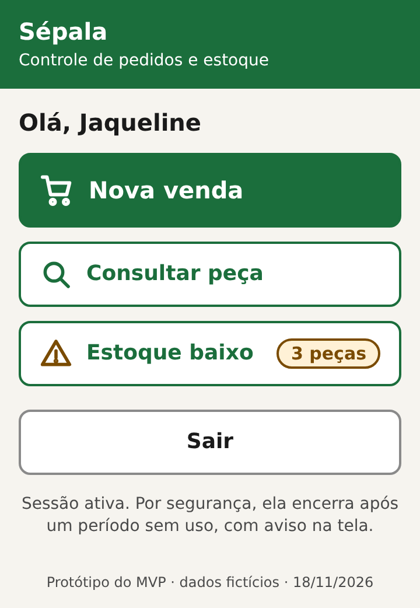
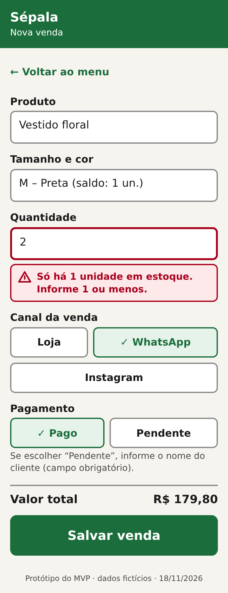
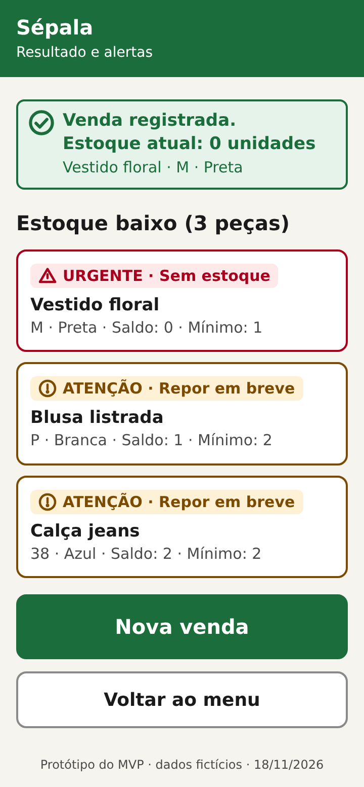

# Sépala Estoque (MVP)

MVP de controle de pedidos e estoque por tamanho e cor para um pequeno
comércio de roupas de Foz do Iguaçu/PR. Projeto de extensão da disciplina
de Projeto de Software, alinhado ao **ODS 8** (Trabalho Decente e
Crescimento Econômico), metas 8.2 e 8.3.

> Observação: o nome do repositório é `cds-p`; o projeto é o **Sépala Estoque**.

## Problema
A gestão de pedidos e estoque é manual (caderno, planilha simples e
WhatsApp). Isso causa pedidos esquecidos, venda de peças que já acabaram e
falta de dados para decidir compras.

## Escopo do MVP
Obrigatório:
- RF01 Cadastro de produtos com variações (tamanho e cor)
- RF02 Registro de venda com baixa automática do estoque
- RF03 Recusa de venda sem saldo suficiente
- RF04 Consulta de disponibilidade por tamanho e cor
- RF05 Login obrigatório

Desejável:
- RF06 Alerta de estoque baixo
- RF07 Relatório mensal

Fora do escopo: integração com WhatsApp/Instagram, pagamentos online,
nota fiscal, loja virtual e aplicativo nativo.

## Tecnologia (planejada)
- Python 3.12 e Django 5.2 LTS (arquitetura monolítica em três camadas)
- PostgreSQL (hospedado)
- Bootstrap 5.3, com recursos de PWA para consulta em cache

## Estrutura
- `docs/prototipo/` capturas do protótipo (dados fictícios)
- `app/` aplicação Django (`config/` configuração, `estoque/` modelos, serviços, views e testes)

## Protótipo
Telas fictícias do fluxo central: menu inicial, nova venda e alertas.





## Segurança e privacidade
Nenhuma credencial é versionada; configurações ficam em variáveis de
ambiente. O protótipo usa apenas dados fictícios.

## Como executar (desenvolvimento)
```bash
cd app
python -m venv .venv && source .venv/bin/activate
pip install -r requirements.txt
python manage.py migrate
python manage.py createsuperuser   # crie o usuário de acesso
DJANGO_DEBUG=1 python manage.py runserver
```
Variáveis de ambiente: `DJANGO_SECRET_KEY`, `DJANGO_DEBUG`,
`DJANGO_ALLOWED_HOSTS` e, para PostgreSQL, `DB_NAME`, `DB_USER`,
`DB_PASSWORD`, `DB_HOST`, `DB_PORT`. Sem `DB_NAME`, usa SQLite local.

## Testes
```bash
cd app && python manage.py test estoque
```
Cobrem baixa de estoque, recusa sem saldo, atomicidade, login
obrigatório, escape de scripts e consultas seguras.

## Status
Núcleo do MVP implementado (RF01 a RF06). Pendentes: relatório mensal
(RF07), PWA e implantação.
